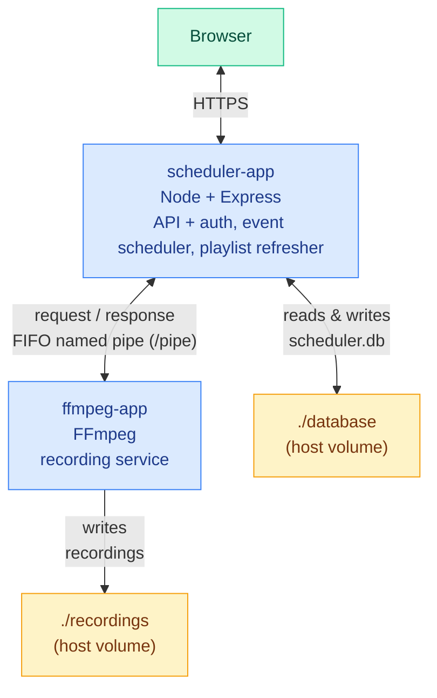

# Scheduler App

A full-stack web application for managing playlists, schedules, and events with automated recording using FFmpeg. Features user authentication, playlist management, schedule creation, and backend services for event execution and playlist refreshing.

## 📋 Features

- User authentication (login only — no registration)
- Login rate limiting per IP (15-minute sliding window, 20 attempts)
- Playlist management (create, auto-refresh, manual refresh, delete)
- Schedule events for automated recording
- Recording protection: events currently recording cannot be edited or deleted
- Persistent SQLite storage
- Graceful shutdown via custom container entrypoints
- Dockerized deployment

## 🛠️ Tech Stack

- **Frontend**: React 19 (Vite), JSX, plain CSS
- **Backend**: Node.js, Express 5
- **Database**: SQLite (`better-sqlite3`)
- **Auth**: JWT (24h tokens), `bcryptjs`
- **Media Processing**: FFmpeg
- **Containerization**: Docker, Docker Compose
- **API**: RESTful endpoints for auth, events, playlists

## 🏃 Quick Start

- Start services:
   ```
   docker compose up -d
   ```
- Access the app: http://localhost:3000 (admin / admin123)

## Architecture

The app is made of two coordinated services, wired together with named FIFO pipes:



- **`app/`** — the Node.js/Express server. It serves the built React client, exposes the REST API, and runs two background schedulers:
  - **Event runner** (`services/event-runner.js`): polls every minute for events starting in the next 24h, schedules each with a `setTimeout`, and writes a recording command to `/pipe/request`. It reads completion results back from `/pipe/response` and updates the recording status in the DB. Events whose start time passed while the server was down are marked `missed`.
  - **Playlist refresher** (`services/playlist-refresher.js`): parses `.m3u`/`.m3u8` playlists and periodically refreshes (every 12h) playlists that haven't been updated in the last 24h. Creating a playlist also triggers an immediate refresh.
- **`app/entrypoint.sh`** — keeps `node server.js` as a child of the shell so it receives SIGTERM for graceful shutdown (stopping schedulers and closing the DB), rather than being re-exec'd as PID 1.
- **`ffmpeg-app/`** — a small FFmpeg service (runs in `host` network mode) that consumes recording commands from `/pipe/request` and writes `.mp4` files to `/recordings`.
- **`database/`** — SQLite database, persisted to the host via a named volume.

## ⚙️ Configuration

Configuration is done entirely through environment variables in `docker-compose.yaml`:

| Variable | Default | Description |
| --- | --- | --- |
| `USERS` | `admin:admin123` | Comma-separated `username:password` pairs. Seeded into the DB on startup. |
| `JWT_SECRET` | random UUID | Signs 24h auth tokens. **A random secret invalidates all sessions on restart — set it explicitly in production.** |
| `APP_PORT` | `3000` | Port the server listens on. |

### Ports & Volumes

| Target | Host | Purpose |
| --- | --- | --- |
| `scheduler-app` | `3000` | Web app + API |
| `ffmpeg-app` | `host` network | FFmpeg recording |
| `./database` | `scheduler-app` volume | SQLite persistence |
| `./recordings` | `ffmpeg-app` volume | Recorded `.mp4` files |

## 🔌 API

All endpoints except `POST /api/auth/login` require a JWT bearer token (`Authorization: Bearer <token>`); a missing or invalid token returns `401`.

### Auth

| Method | Path | Auth | Description |
| --- | --- | --- | --- |
| POST | `/api/auth/login` | No | Logs in with `username` + `password`; returns `{ token, userId, username }`. Per-IP rate-limited (429 when exceeded). |

### Events

| Method | Path | Auth | Description |
| --- | --- | --- | --- |
| GET | `/api/events` | Yes | List all events (joined with playlist stream data). |
| POST | `/api/events` | Yes | Create an event. Body: `{ name, start_time, end_time, playlist_entry_id }` (Unix timestamps in seconds). |
| PUT | `/api/events/:id` | Yes | Update an event. Refuses events currently recording (`409`). |
| DELETE | `/api/events/:id` | Yes | Delete an event. Refuses events currently recording (`409`). |

### Playlists

| Method | Path | Auth | Description |
| --- | --- | --- | --- |
| GET | `/api/playlists` | Yes | List all playlists. |
| GET | `/api/playlists/:id` | Yes | List entries in a playlist. |
| POST | `/api/playlists` | Yes | Create a playlist and trigger an immediate refresh. |
| DELETE | `/api/playlists/:id` | Yes | Delete a playlist. |
| POST | `/api/playlists/:id` | Yes | Refresh a playlist. |

## 🗄️ Database Schema

SQLite tables created on startup:

- **`users`** — `id`, `username` (unique), `password_hash` (bcrypt), `created_at`
- **`playlists`** — `id`, `url` (unique), `name`, `last_refreshed`, `created_at`
- **`playlist_entries`** — `id`, `playlist_id` (FK), `entry_url`, `title`, `logo`, `created_at` (indexed by `entry_url` and `playlist_id`)
- **`events`** — `id`, `name`, `start_time`, `end_time`, `playlist_entry_id` (FK), `created_by` (FK), `created_at`, `recording_file`, `recording_status` (one of `scheduled` / `started` / `completed` / `failed` / `missed`)

## Development

The server package lives in `app/server` — run it from there (it is also the Docker build context):

```bash
cd app/server
npm install
npm start            # server on port 3000
```

Frontend dev server (requires a running server, or set a proxy in `vite.config.js`):

```bash
cd app/client
npm install
npm run dev
```
